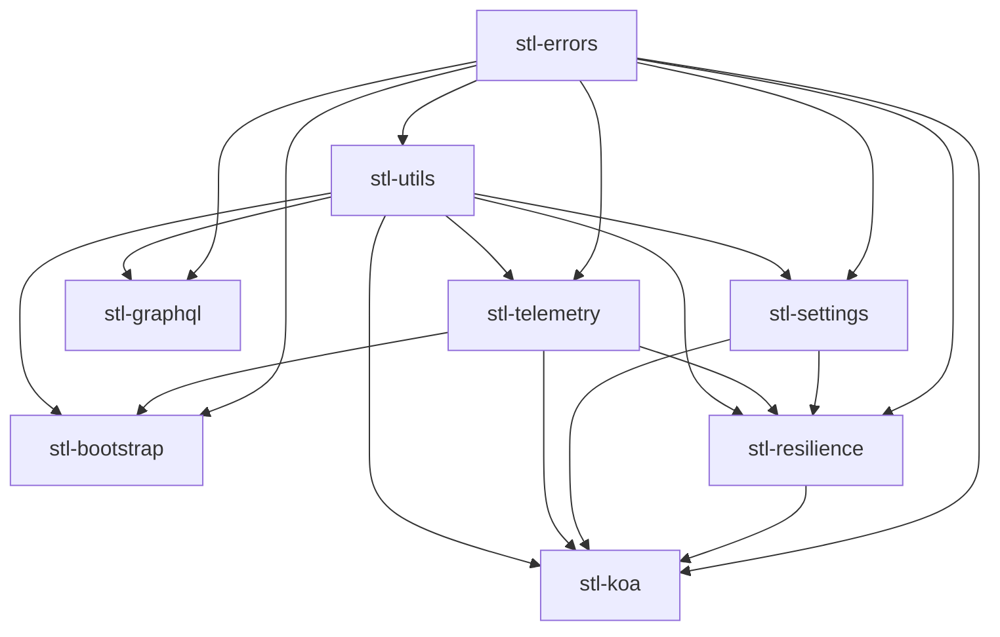

# TypeScript development toolkit

A collection of tools, libraries, and configurations useful for writing
TypeScript.

## Packages

* Configurations
  * [`@mtth/eslint-plugin`](packages/configs/eslint-plugin)
  * [`@mtth/prettier-typescript`](packages/configs/prettier-typescript)
  * [`@mtth/tsconfig`](packages/configs/tsconfig)

* Libraries
  * [`@mtth/stl-bootstrap`](packages/libs/stl-bootstrap)
  * [`@mtth/stl-errors`](packages/libs/stl-errors)
  * [`@mtth/stl-graphql`](packages/libs/stl-graphql)
  * [`@mtth/stl-koa`](packages/libs/stl-koa)
  * [`@mtth/stl-resilience`](packages/libs/stl-resilience)
  * [`@mtth/stl-settings`](packages/libs/stl-settings)
  * [`@mtth/stl-telemetry`](packages/libs/stl-telemetry)
  * [`@mtth/stl-utils`](packages/libs/stl-utils)

* Tools
  * [`@mtth/inlinable`](packages/tools/inlinable)

## Libraries dependency flow

